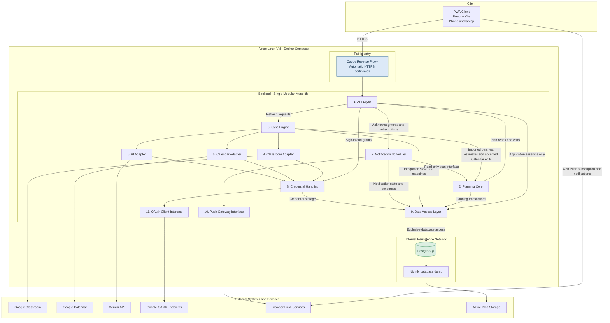

# Architecture.md
# AI Academic Deadline Planner

**Status:** Consolidated architectural baseline for Deliverable 3, Task 8. Architecture aligned with the validated PRD through DL-17 on 15 November 2026. DL-17 and the corresponding ADR amendments were re-approved 27 November 2026 (DL-25). Open conditions remain subject to the decision log.

## 1. System overview

The AI Academic Deadline Planner is a Google Classroom-linked academic deadline planner for students. It retrieves academic assignments, estimates effort using an external AI service, calculates personalized start-by dates, sends notifications to students' phones and laptops, and synchronizes study-plan blocks with Google Calendar.

The selected architecture is a **server-authoritative modular monolith with a single Progressive Web App (PWA) client**.

The system consists of:

- One PWA client built with React and Vite, supporting phone and laptop browsers.
- One backend application organized into exactly eleven modules/interfaces.
- One PostgreSQL database serving as the server-side single source of truth.
- External Google Classroom, Google Calendar, Gemini API, Google OAuth and browser push services.

The backend is one deployable application. Its modules have explicitly defined responsibilities, interfaces and allowed dependency directions. The architecture does not use microservices.

The PWA is responsible for presentation and communication with the backend through the API Layer. It does not contain business rules, communicate directly with external services or persist academic data on the device. It may cache its static application shell.

The server owns academic data, planning calculations, synchronization state, credentials, notification state and transaction management.

## 2. Architectural goals and drivers

The architecture is shaped by the following requirements and constraints:

- **External integration:** Connect with Google Classroom, Google Calendar and Gemini through defined integration boundaries.
- **Availability of saved information:** Previously saved assignments and study plans remain viewable when Classroom or Calendar is unavailable.
- **Transaction integrity:** Maintain ACID-compliant transactions for changes to plan state.
- **Cross-device consistency:** Synchronize notification acknowledgment state between phone and laptop.
- **Reliable background work:** Run synchronization, notification repeats and retries independently of whether a client is open.
- **Recalculation consistency:** Recalculate affected start-by dates while preserving Student-entered overrides.
- **Security and privacy:** Protect Google credentials and academic data, restrict external AI payloads and handle access revocation.
- **Project feasibility:** Keep the architecture manageable for a four-member team and the course-project timeline.

### Architectural tensions and responses

- **T-01 — Local ACID transactions versus cross-device acknowledgment synchronization:** The server-side relational database provides transaction integrity and shared acknowledgment state across devices. The client does not maintain a separate persistent academic-data store. The interpretation of "local" remains subject to DL-01 and Gate 3.
- **T-02 — AI-derived effort estimates versus reliable plan calculations when the AI service is unavailable:** The AI Adapter isolates the external service. The recorded failure behaviour retains a previous estimate, or represents no estimate when none exists, while allowing a Student manual effort override. DL-05 remains subject to confirmation.
- **T-03 — Calendar edits versus Student overrides:** The recorded Calendar conflict and authority rules determine which changes take precedence. Student edits take precedence over calculated values. A Calendar time change is accepted only if it fits the official deadline and available hours; otherwise, it becomes a conflict for the Student to resolve. Between valid Student edits, the later edit wins, while the earlier edit is logged and shown.
- **T-04 — AI estimation versus academic-data privacy:** The AI Adapter enforces the recorded payload allow-list, restricting the academic information sent to the external AI service. Real Student data is restricted to the AI provider's paid tier.

## 3. Architecture Significant Requirements (ASRs)

The following requirements are the architectural drivers identified in `ASRs_and_Architectural_Drivers.md`. PC-01 is a project constraint, not an ASR.

| ID | Requirement summary | Architectural impact |
|---|---|---|
| ASR-01 | Google Classroom integration: retrieve assignment information, deadlines and submission status. | Requires a Classroom integration boundary, synchronization and handling of unavailable or incomplete external data. |
| ASR-02 | Two-way Google Calendar synchronization of study-plan blocks, including permitted manual changes. | Requires a separate Calendar boundary, bidirectional synchronization, conflict handling and recovery from failures. |
| ASR-03 | Previously saved assignments and the study plan remain viewable during Classroom or Calendar outages. | Requires persistent system-owned data and separation of saved-data access from external synchronization. |
| ASR-04 | ACID-compliant local transactions under C-05 and V-08. | Requires transaction ownership, atomic multi-record changes, durability and isolation between concurrent writers. |
| ASR-05 | Handle Classroom access revocation and reconnection while preserving in-progress saved edits and reconciling retained records. | Requires credential cleanup, retention boundaries, safe disconnection and identity reconciliation. |
| ASR-06 | Deliver phone and laptop notifications, repeat unacknowledged notifications and synchronize acknowledgment state across devices. | Requires persistent notification state, background scheduling, reliable delivery and cross-device consistency. |
| ASR-07 | Recalculate affected start-by dates when relevant inputs change while preserving Student overrides. | Requires clear ownership of calculated and manually overridden values, consistent recalculation and concurrency handling. |
| ASR-08 | Identify possible course neglect using available progress evidence and communicate uncertainty when evidence is incomplete. | Requires explicit representation of unknown progress and careful handling of derived warnings. |
| ASR-09 | AI effort estimation as an external dependency, with assignment-list and start-by display within three seconds for up to 50 assignments. | Requires an AI service boundary, stored estimates and handling of slow, unavailable or invalid AI responses. |
| ASR-10 | Security and privacy of Google-linked data. | Requires controlled credential access, minimum necessary scopes, protection of stored academic data and limits on information sent externally. |
| PC-01 | Four-member team and fixed course-project timeline. | Influences architectural simplicity and the amount of operational and integration complexity the team can reasonably manage. |

## 4. Selected architectural style and rationale

**Selected style: Server-authoritative modular monolith with a single PWA client.**

The backend is one deployable application divided into eleven explicitly defined modules/interfaces. The PWA is the single client used on Android phones and laptop browsers.

This option was selected because:

- A single server-side source of truth supports consistent acknowledgment state across devices.
- Background synchronization and notification scheduling do not depend on an open browser tab or a running phone client.
- One client codebase is more feasible for the four-member team than separate native and web clients.
- Defined module boundaries separate responsibilities without the deployment and operational overhead of microservices.
- A server-side relational database supports multi-record ACID transactions.
- External services remain isolated behind their respective adapters and interfaces.
- The Data Access Layer provides one controlled database-access boundary.

The team considered a native Android application alongside a web client, local-first device databases and microservices. These alternatives were not selected because of their additional implementation, synchronization, deployment or project-feasibility costs.

The interpretation of "local" in C-05 and V-08 remains subject to TA confirmation under DL-01 and Gate 3.

## 5. Major components and modules

### 5.1 Client component

| Component | Responsibility | Boundary |
|---|---|---|
| PWA Client | Presentation on phone and laptop; displays application data and push notifications; caches the static application shell. | Must not hold business rules, communicate directly with external services or persist academic data on the device. |

### 5.2 Closed backend module/interface inventory

The backend inventory is strictly closed to **exactly eleven modules/interfaces**. No additional backend module, shared kernel, generic gateway or unauthorized utility module is part of this architecture.

| # | Module / interface | Responsibility | Boundary: what it must not do |
|---:|---|---|---|
| 1 | **API Layer** | Entry point for clients; handles application requests, routing and application sessions; directs requests to the relevant backend modules. | Must not own planning rules or be imported by another backend module. |
| 2 | **Planning Core** | Owns Student-entered planning data and overrides; calculates start-by dates; derives course-neglect warnings using explicit progress states. Owns subtasks, study sessions, timer state, deadline-change notices and the Calendar-edit check against official deadlines and available hours. | Must not know about Google or the AI service. It calls only the Data Access Layer. Subtasks and study time must not change Started, Finished or Submitted status. |
| 3 | **Sync Engine** | Runs integration jobs; coordinates Classroom, Calendar and AI work; imports data, persists adapter results, applies returned estimates and accepted Calendar edits through Planning Core, maintains sync cursors and status, and rebuilds outdated Calendar-derived records. | Must not call external systems except through their adapters. Adapters must not persist their own results. |
| 4 | **Classroom Adapter** | Communicates with Google Classroom and returns external results through its internal interface. | Must not access the Data Access Layer or leak Google-specific types into other modules. |
| 5 | **Calendar Adapter** | Communicates with Google Calendar and handles the Calendar-side representation of study-plan blocks. | Must not access the Data Access Layer or leak Google-specific types into other modules. |
| 6 | **AI Adapter** | Communicates with Gemini, enforces the approved AI payload allow-list and returns effort estimates. | Must not send fields outside the allow-list, log payloads or access the Data Access Layer. |
| 7 | **Notification Scheduler** | Owns notification schedules, daily repeats, push subscriptions, acknowledgment updates, the 48-hour pause after "Got it", stop rules and notification sending. Rebuilds schedules whose stored plan version is outdated. | Must not allow another module to send notifications, call Planning Core write operations or send push inside a database transaction. |
| 8 | **Credential Handling** | Manages Google grants and scopes, encrypted refresh tokens, short-lived access tokens, revocation detection and credential cleanup. | Must not allow other modules to read stored credentials or log tokens and keys. |
| 9 | **Data Access Layer** | The exclusive database-access boundary. Owns PostgreSQL connections, SQL access, transaction boundaries, version-checked writes and versioned SQL migrations. | Must not be bypassed or contain planning and integration responsibilities. |
| 10 | **Push Gateway Interface** | The single boundary for sending Web Push notifications through browser push services. | Must not become a scheduling or general notification module. |
| 11 | **OAuth Client Interface** | The single boundary for Google OAuth calls, including authorization-code exchange, token refresh and revocation. | Must not be used by any module other than Credential Handling. |

The eleven entries above are the complete backend module/interface inventory. No additional backend module is authorized.

## 6. Interfaces and interactions between components

Modules communicate through defined public interfaces. Dependency directions follow ADR-001 and the recorded dependency clarifications.

### 6.1 Interface table

| From | To | Nature of interaction |
|---|---|---|
| PWA Client | API Layer | HTTPS requests carrying the application session cookie. |
| API Layer | Planning Core | Plan reads and Student edits. |
| API Layer | Notification Scheduler | Acknowledgment and push-subscription requests. |
| API Layer | Sync Engine | Requests to refresh integration data. |
| API Layer | Credential Handling | Sign-in, grant and disconnect requests. |
| API Layer | Data Access Layer | Application sessions only: issue, validate and expire. |
| Planning Core | Data Access Layer | Reads and writes through transactions owned by the Data Access Layer. |
| Sync Engine | Classroom Adapter | Retrieves Classroom data through the adapter interface. |
| Sync Engine | Calendar Adapter | Retrieves Calendar changes and applies Calendar-side synchronization through the adapter interface. |
| Sync Engine | AI Adapter | Requests effort estimation through the adapter interface. |
| Sync Engine | Planning Core | Applies imported batches, returned estimates and accepted Calendar edits through the Planning Core interface. |
| Sync Engine | Data Access Layer | Persists integration jobs, adapter results, cursors, mappings and synchronization status. |
| Notification Scheduler | Planning Core | Read-only access to upcoming start-by items, their plan versions and assignment status. |
| Notification Scheduler | Data Access Layer | Reads and writes notification state and schedules through DAL. |
| Notification Scheduler | Push Gateway Interface | Sends Web Push messages through the defined interface. |
| Classroom, Calendar and AI Adapters | Credential Handling | Requests short-lived access tokens for the relevant Student and service. |
| Credential Handling | Data Access Layer | Persists and retrieves protected credential records through DAL. |
| Credential Handling | OAuth Client Interface | Requests Google OAuth operations through the defined interface. |
| OAuth Client Interface | Google OAuth endpoints | Authorization-code exchange, token refresh and revocation. |
| Classroom Adapter | Google Classroom | External HTTPS integration. |
| Calendar Adapter | Google Calendar | External HTTPS integration. |
| AI Adapter | Gemini API | External AI estimation requests. |
| Push Gateway Interface | Browser push services | Web Push delivery through the approved transport. |
| Data Access Layer | PostgreSQL | Exclusive database access. |

### 6.2 Allowed-dependency table

A backend module may depend only on the modules listed in its row. The dependency list is exhaustive.

| Module | May depend on |
|---|---|
| API Layer | Planning Core, Notification Scheduler, Sync Engine, Credential Handling, Data Access Layer (application sessions only) |
| Planning Core | Data Access Layer only |
| Sync Engine | Classroom Adapter, Calendar Adapter, AI Adapter, Planning Core, Data Access Layer |
| Classroom Adapter | Credential Handling and Google Classroom external boundary |
| Calendar Adapter | Credential Handling and Google Calendar external boundary |
| AI Adapter | Credential Handling and Gemini external boundary |
| Notification Scheduler | Planning Core (read-only interface), Data Access Layer, Push Gateway Interface |
| Credential Handling | Data Access Layer, OAuth Client Interface |
| Data Access Layer | PostgreSQL only |
| Push Gateway Interface | Browser push services only |
| OAuth Client Interface | Google OAuth endpoints only |

The dependency table is enforced in CI using dependency-cruiser and an explicit allowed-dependency list. Unlisted cross-module imports must fail the build. Internal imports within a module are permitted, but other modules must import only the target module's single public entry file, `index.ts`.

Nothing depends on the API Layer. Planning Core calls no module except the Data Access Layer. Adapters never access the database.

**Restricted dependencies:**

- API Layer → Data Access Layer is permitted only for application-session operations.
- Notification Scheduler → Planning Core is permitted only through read-only operations returning upcoming start-by items, plan versions and assignment status.

The automated import check enforces module direction, but it cannot independently prove that a function call is sessions-only or read-only. These restrictions also require interface-level review.

### 6.3 Data ownership and plan-version flow

Planning Core owns the planning state and calculated start-by dates. It does not directly call Sync Engine, Calendar Adapter or Notification Scheduler after recalculation.

Instead, Calendar synchronization and notification scheduling operate through stored plan-version comparisons.

The mechanism is:

1. Planning Core processes a Student edit or an accepted incoming change through its interface.
2. The relevant planning changes are committed through the Data Access Layer.
3. The current plan version is stored with the planning state.
4. Calendar block records and notification schedule records each store the plan version from which they were built.
5. Sync Engine compares the Calendar block's stored plan version with the current plan version.
6. Notification Scheduler compares the notification schedule's stored plan version with the current plan version.
7. When a version differs, the owning subsystem rebuilds its own derived records using the current stored planning state.
8. The subsystem updates its stored version after the derived record is rebuilt.

This keeps dependencies unidirectional: Planning Core does not call the derived subsystems. The Sync Engine and Notification Scheduler independently detect outdated derived records.

A recalculation does not wait for Calendar or notification work. Derived records may temporarily lag behind the current plan until their owners process the version difference.

Changes flowing in the other direction are explicit:

- Imported Classroom batches reach Planning Core through Sync Engine.
- Returned AI estimates reach Planning Core through Sync Engine.
- Accepted Calendar edits reach Planning Core through Sync Engine.
- Each such planning change is applied through the Planning Core interface as one transaction.

This preserves ownership of planning rules while allowing external integrations to update planning state through the defined path.

**Source:** ADR-002 rule 9; ADR-004; ADR-005; AGENTS.md §4.

## 7. Relevant external systems and services

| External system / service | Purpose | System boundary |
|---|---|---|
| Google sign-in and OAuth endpoints | Student identity, authorization-code exchange, token refresh and revocation. | Credential Handling through OAuth Client Interface. Application sessions remain in API Layer. |
| Google Classroom | Courses, coursework, deadlines and submission information. | Classroom Adapter only. |
| Google Calendar | Study-plan blocks and permitted Calendar-side changes. | Calendar Adapter only. |
| Gemini API | External AI effort estimation. | AI Adapter only. |
| Browser push services | Deliver Web Push notifications to supported phone and laptop browsers. | Push Gateway Interface, used by Notification Scheduler. |
| PostgreSQL | Persistent server-side source of truth. | Data Access Layer only. |
| Azure hosting environment | Runs the backend, database and reverse proxy. | Infrastructure boundary; not an additional application module. |
| Azure Blob Storage | Receives the nightly database backup copy. | Backup destination, not an application module. |

### 7.1 External integration boundaries

- Only Classroom Adapter communicates with Google Classroom.
- Only Calendar Adapter communicates with Google Calendar.
- Only AI Adapter communicates with Gemini.
- Only Credential Handling uses OAuth Client Interface.
- Only Notification Scheduler sends notifications, using Push Gateway Interface.
- Only Data Access Layer communicates with PostgreSQL.

The PWA does not call Google or Gemini directly.

## 8. Important data responsibilities

The server-side PostgreSQL database is the single source of truth. The Data Access Layer is the only backend module that accesses it.

| Data | Responsible component / owner | Storage and responsibility |
|---|---|---|
| Imported Classroom records | Sync Engine, through Classroom Adapter | Stored in the database. Google remains the source for imported fields; stable Classroom identifiers identify imported records. |
| Student-entered data | Planning Core | Availability, skill ratings and manual deadlines are stored in the database. |
| Student overrides | Planning Core | Manual effort, manual start-by dates and accepted Calendar edits are stored separately from calculated values. |
| AI effort estimates | AI Adapter produces them; DAL stores them | Stored separately from Student overrides, with estimate state and timestamp. |
| Subtasks | Planning Core | Stored under their assignment: title, completed flag and timestamps. They are not planning inputs and never change Started, Finished or Submitted status, effort or start-by dates (BR-20, DL-16). |
| Study sessions | Planning Core | Stored under their assignment, one row per completed session with duration. Recorded study time is separate from the Effort estimate and reported remaining effort (BR-21, DL-16). |
| Study timer state | Planning Core | Stored on the server, never on a device. Held as a start time plus pause and resume events. Duration is computed from stored timestamps. Stopping the timer saves a study session (FR-16, DL-16). |
| Calculated start-by dates | Planning Core | Derived from stored inputs and stored separately from overrides. |
| Progress evidence | Sync Engine and Student | Stored with an explicit Observed or Unknown state and timestamp. Unknown is never treated as "no activity." |
| Course-neglect warnings | Planning Core | Recomputed from progress evidence. Warnings based on Unknown evidence carry an uncertainty indication. |
| Deadline-change notices | Planning Core | Stored in the database when an import batch changes an official deadline, once per assignment per change. The latest deadline is applied and affected start-by dates are recalculated once. Multiple changes before processing produce one notice per assignment. Under ADR-003 and DL-17, this is a Notification delivered to the Student's devices, subject to the one-Notification-per-assignment-per-day limit. DL-17 was re-approved 27 November 2026 (DL-25). |
| Calendar block mapping and sync state | Sync Engine | Stored in the database. Calendar block records carry the plan version from which they were built. A block that violates the official deadline or available hours carries Conflict status. |
| Notification and acknowledgment state | Notification Scheduler | Stored in the database. Schedule records carry the plan version from which they were built. Each assignment also stores the end of its start-reminder pause. |
| Sync cursors | Sync Engine | Stored in the database, including last successful sync times and Calendar sync tokens. |
| Application sessions | API Layer, through DAL | Session records are stored in the database. API Layer issues and validates application sessions through the sessions-only DAL interface. |
| Access credentials | Credential Handling | Refresh tokens are encrypted at rest. Access tokens are short-lived and kept in memory only. |
| Retention after Classroom revocation | Credential Handling and relevant data owners | Stored tokens are deleted immediately. Imported assignments remain available, marked disconnected and stale, pending the Student's keep-or-delete choice. Keeping retains attached data. Deleting removes assignments and attached overrides, subtasks, study sessions, timer state and notification schedules, following the required warning and confirmation. Student-owned availability and skill ratings remain either way. The Student can also delete everything from the app. The keep-or-delete choice is a PRD requirement; the detailed DL-08 default awaits confirmation of OQ-27. |

## 9. Architectural constraints

### 9.1 Runtime and deployment constraints

- The v1 system runs as exactly one backend instance. Running more than one instance requires a new ADR.
- The architecture is a modular monolith, not microservices.
- Clients communicate only with the API Layer.
- Only the reverse proxy is reachable from the internet.
- PostgreSQL is never exposed to the internet.
- PostgreSQL listens only on the internal Docker network.
- The host must provide public HTTPS with a valid certificate, an always-on backend process and persistent database storage with backups.
- The PWA caches only its static application shell. Academic data is not persisted on the device.
- Scheduled work runs inside the backend process using a database-backed job table. No external queue, scheduler service or cache is introduced.
- Polling is the base synchronization mechanism. Push may trigger the same synchronization path.

### 9.2 Database and transaction constraints

- Only the Data Access Layer accesses PostgreSQL.
- The Data Access Layer owns database connections, SQL execution, transaction boundaries and version-checked writes.
- All versioned SQL migration files reside strictly inside the Data Access Layer's `migrations/` directory.
- External calls never run inside a database transaction. The system records intent, performs the external call, and records the outcome in a second transaction.
- A write based on an outdated version fails and is retried from fresh data.
- The wider use of ACID transactions beyond the literal scope of C-05, such as saving local edits before disconnection or performing token-revocation cleanup atomically, is the team's design choice recorded in ADR-002.

### 9.3 Security and privacy constraints

- Only Credential Handling reads stored credentials.
- Refresh tokens are encrypted at rest.
- Access tokens are short-lived and kept in memory only.
- OAuth client secrets, token encryption keys and push signing keys are supplied through the host environment, never committed to the repository or written to logs.
- The AI Adapter enforces the approved payload allow-list.
- Real Student data is sent only to the AI provider's paid tier. The free tier is for synthetic data in development and tests.
- AI payloads are never logged.
- Only the Notification Scheduler sends notifications.
- Each notification send has an idempotency key. The first acknowledgment wins.

### 9.4 Technology and architectural restrictions

No new framework, database, external service, queue, cache, message broker, backend module or architectural layer may be introduced without a new ADR and explicit human approval.

The architecture-level technology decisions are:

| Architecture-level area | Decision |
|---|---|
| Database | PostgreSQL |
| Client notification approach | PWA with Web Push |
| AI service | Gemini API |
| Hosting | Azure Linux VM |

The detailed implementation technologies and libraries are recorded in ADR-001 and `AGENTS.md`. They are not repeated here as additional architectural decisions.

### 9.5 Hosting and infrastructure decision

**Selected hosting: One Azure Linux virtual machine, using Docker Compose.**

The hosting decision was recorded on 15 November 2026 under DL-02.

The VM runs exactly three containers:

| Container | Responsibility |
|---|---|
| Backend | Runs the single backend application and its in-process scheduled work. |
| PostgreSQL | Stores persistent application data and database state. |
| Reverse proxy | Receives public HTTPS traffic and forwards application requests to the backend. |

**Reverse proxy:** Caddy by default.

Caddy obtains and renews the public HTTPS certificate automatically. The public endpoint uses the Azure VM's public IP and DNS name label, with the recorded hostname format `label.region.cloudapp.azure.com`. The hosting decision records that a separate domain purchase is not required for this arrangement.

**Network exposure:**

- The reverse proxy is the only internet-reachable container.
- The backend is reachable through the internal container network.
- PostgreSQL listens on the internal Docker network only.
- The database must never be exposed publicly.

**Persistent storage and backups:**

- PostgreSQL data files reside on the VM's persistent disk.
- A nightly database dump is copied off the VM to Azure Blob Storage.
- The VM provides an always-on backend process and persistent database storage.

**Secret injection:**

- Secrets are supplied through an environment file outside the repository.
- The environment file is readable only by the service account.
- Secrets must never be committed to source control or included in logs.

**Hosting conditions:**

- Azure for Students eligibility and credit availability remain unconfirmed.
- The selected VM size and actual credit consumption require verification.
- The fallback hosting choices recorded in ADR-001 remain subject to the team's decision if Azure hosting is unavailable.

**Source:** ADR-001, hosting decision D1–D4; DL-02.

### 9.6 Open conditions

The following items must not be treated as finalized without the required confirmation:

- **DL-01:** The interpretation of "local" in C-05 and V-08 remains an assumption awaiting TA confirmation. Gate 3 has not been run.
- **DL-05:** AI failure behaviour remains subject to the recorded PRD/TA confirmation.
- **DL-06:** The AI payload allow-list default awaits the relevant confirmation.
- **DL-07:** Calendar-edit defaults await confirmation, including the recorded PRD alignment.
- **DL-08:** The detailed retention default after Classroom revocation awaits confirmation of OQ-27.
- **DL-09:** Notification parameters and delivery-failure behaviour await the relevant OQ-18, OQ-22 and OQ-23 answers and Gate 1.
- **DL-10:** The interpretation of NFR-03 remains an assumption awaiting TA confirmation.
- **DL-17:** The alignment of ADR-002 through ADR-006 with the validated PRD was re-approved 27 November 2026 (DL-25).
- **Gate 1:** Notification delivery test on the team's Android phones and laptop has not been run.
- **Gate 2:** Real Google account and Classroom integration test has not been run.
- **Gate 3:** TA confirmation of the interpretation of "local" has not been obtained.
- Azure for Students eligibility and the AI billing account still require confirmation.
- OQ-34 remains open only for device delivery of course-balance notices and urgent start-by warnings. Deadline-change Notifications are specified as device-delivered by ADR-003 and DL-17, which was re-approved 27 November 2026 (DL-25).
- The remaining open questions and their status are recorded in `decision-log.md`.

## 10. Architecture diagram

**Diagram interpretation:**

- The eleven backend modules/interfaces are shown inside one backend deployment.
- PostgreSQL is a separate persistence component, not a backend module.
- Only Caddy is publicly reachable.
- The Data Access Layer is the sole PostgreSQL access path.
- External services are reached only through their respective adapters and interfaces.
- The PWA communicates with the backend through the reverse proxy and API Layer.
- Calendar and notification derived records follow plan-version comparison rather than direct calls from Planning Core.
- The diagram represents architectural boundaries, not an additional service decomposition.

## 11. Related Architecture Decision Records

The following ADRs define and justify the architecture decisions consolidated in this document:

- **ADR-001:** Architecture Style and System Structure — modular monolith, module boundaries, allowed dependencies, technology selection, hosting and deployment.
- **ADR-002:** Data Persistence and Ownership — data ownership, transaction boundaries, version-checked writes and plan-version-based derived records.
- **ADR-003:** External Integration and Synchronization — Classroom, Calendar and AI integration, polling, synchronization and deadline-change notices.
- **ADR-004:** Calendar Synchronization and Conflicts — Calendar block mapping, permitted edits, authority rules and conflict handling.
- **ADR-005:** Notification Delivery and Acknowledgment — notification scheduling, repeats, Web Push delivery and acknowledgment state.
- **ADR-006:** Identity, Credentials and Privacy — Google OAuth, credential handling, access control and AI data privacy.

The ADRs take precedence over this architecture document. Any proposed change to their recorded decisions must follow the team's ADR and human-approval process.